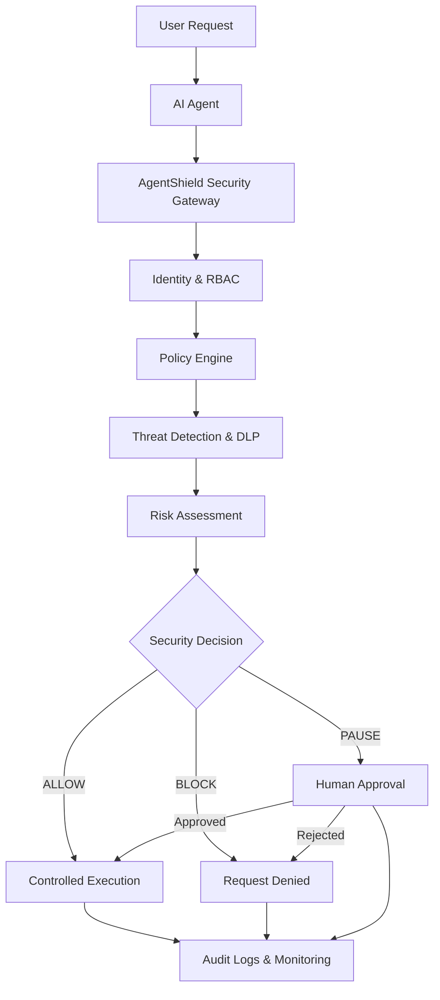

# 🛡️ AgentShield
### Securing the Next Generation of Autonomous AI Agents

**An AI Agent Security & Governance Gateway that monitors, evaluates, and controls AI-agent actions before they interact with sensitive tools, systems, and resources.**

[](https://react.dev/)
[](https://www.typescriptlang.org/)
[](https://nodejs.org/)
[](https://expressjs.com/)
[](https://www.sqlite.org/)
[](https://vite.dev/)

---

## 🚨 The Problem

AI agents are rapidly evolving from simple chatbots into autonomous systems capable of accessing databases, sending emails, processing transactions, and interacting with external services.

But greater autonomy introduces a serious security challenge.

**What happens when an AI agent makes an unauthorized decision?**

An agent might:
- Access confidential information without permission.
- Attempt unauthorized financial transactions.
- Expose sensitive customer information.
- Execute malicious or manipulated instructions.
- Perform actions beyond its assigned privileges.

Traditional security systems primarily focus on protecting users and applications. Autonomous AI agents introduce a different challenge: controlling what an AI agent is allowed to do while it is operating.

## 💡 Our Solution: AgentShield

AgentShield is an AI-agent security and governance gateway that acts as a protective layer between autonomous agents and the tools or resources they want to access.

Instead of blindly trusting an AI agent, AgentShield evaluates its actions before execution.

Every intercepted request passes through security checks, including:

- Identity and permission verification.
- Role-Based Access Control (RBAC).
- Policy and resource-limit validation.
- Risk assessment.
- Threat and suspicious-behavior detection.
- Sensitive-data and Data Loss Prevention (DLP) checks.

Based on these checks, AgentShield makes one of three decisions:

| Decision | Meaning |
|---|---|
| 🟢 ALLOW | The request passes security checks and can proceed. |
| 🔴 BLOCK | The request violates security policies and is denied. |
| 🟡 PAUSE | The request requires human approval before proceeding. |

**Our core philosophy: Never blindly trust an AI agent. Verify every action before execution.**

---

## ⚙️ How AgentShield Works

The AgentShield security workflow follows these steps:

1. **Agent Request:** An AI agent requests access to a tool, database, or resource.
2. **Gateway Interception:** AgentShield intercepts the request before controlled execution.
3. **Identity Verification:** The system checks the agent's identity and assigned permissions.
4. **Policy Validation:** The request is checked against configured security rules and limits.
5. **Threat Analysis:** The system evaluates suspicious behavior, potential prompt-injection threats, and sensitive-data risks.
6. **Risk Assessment:** A risk score is calculated to support the security decision.
7. **Security Decision:** AgentShield returns ALLOW, BLOCK, or PAUSE.
8. **Execution and Auditing:** Permitted actions proceed through the controlled execution flow, while security events and decisions are recorded.

### System Architecture



---

## ✨ Key Features

### 1. AI Security Gateway
A centralized gateway designed to intercept and inspect AI-agent tool requests before controlled execution.

### 2. Role-Based Access Control (RBAC)
Checks whether an agent has the necessary permissions to access a particular resource or perform an operation.

### 3. Intelligent Risk Assessment
Evaluates request characteristics and assigns a risk score to help determine the appropriate security action.

### 4. Policy Enforcement Engine
Enforces configurable rules such as:
- Maximum transaction amount.
- Daily transaction limits.
- Request rate limits.
- Authorized recipients.
- Restricted tools and resources.

### 5. Threat Detection
Evaluates suspicious requests and potential security threats, including prompt-injection patterns and abnormal activity.

### 6. Data Loss Prevention (DLP)
Checks for potentially sensitive information that should not be exposed or transferred without authorization.

### 7. Human-in-the-Loop Approval
High-risk or uncertain operations can be paused for human review rather than being automatically executed.

### 8. Real-Time Security Dashboard
Provides visibility into:
- Agent activity.
- Security events.
- Risk scores.
- Blocked requests.
- Approved and pending actions.
- System monitoring information.

### 9. Agent Management
Provides a centralized interface for managing registered AI agents and viewing their security status.

### 10. Attack Simulator
Demonstrates how AgentShield responds to different types of AI-agent behavior, from legitimate requests to suspicious and unauthorized actions.

### 11. Audit Logs
Maintains a record of security decisions and activity to support monitoring, investigation, and accountability.

### 12. Emergency Security Controls
Includes security-control interfaces for managing and monitoring agent activity.

---

## 🧪 Live Demonstration Scenarios

AgentShield includes a deterministic Mock Mode using a simulated FinanceBot environment to demonstrate security decisions consistently.

### Scenario 1: Normal AI Operation

**User request:**
"Generate a report of today's transactions."

- FinanceBot requests authorized transaction records.
- AgentShield checks its permissions.
- The request passes configured security policies.
- Risk score: approximately 5/100 (illustrative).

**Result: 🟢 ALLOW**

The authorized operation is permitted.

### Scenario 2: Unauthorized Financial Transaction

**User request:**
"Transfer ₹50,00,000 to an unknown recipient."

- AgentShield intercepts the transaction request.
- The policy engine evaluates the transaction amount and recipient.
- The request violates configured financial security policies.
- Risk score: approximately 98/100 (illustrative).

**Result: 🔴 BLOCK**

The unauthorized transaction is denied.

### Scenario 3: Suspicious Data Access

**Agent request:**
"Access confidential customer records."

- AgentShield checks the agent's resource permissions.
- The request attempts to access restricted information.
- The security engine identifies the authorization violation.

**Result: 🔴 BLOCK**

Unauthorized data access is prevented.

### Scenario 4: Uncertain Recipient

**Agent request:**
"Send a payment to a recipient that has not been verified."

- AgentShield evaluates the recipient and applicable policies.
- The request requires additional verification.
- The operation is paused for human review.

**Result: 🟡 PAUSE**

The system requires human authorization before proceeding.

*Note: Risk scores and transaction scenarios are illustrative demonstration values, not independently validated security benchmarks.*

---

## 🏗️ Technology Stack

| Technology | Purpose |
|---|---|
| React 19 | Frontend user interface |
| TypeScript | Type-safe application development |
| Vite | Frontend development and build tooling |
| Tailwind CSS 4 | UI styling |
| Node.js | Backend runtime |
| Express.js | Backend API framework |
| SQLite | Database |
| Axios | API communication |
| Recharts | Dashboard visualizations |
| Gemini | AI integration |
| Mock Mode | Deterministic security demonstrations |
| HMAC-SHA256 | Credential protection |

---

## 🔐 Security Approach

AgentShield follows a security-first architecture built around the principle of least privilege.

Key security concepts include:

- Least-privilege access.
- Role-based authorization.
- Policy-based request validation.
- Risk-based decision-making.
- Sensitive-data inspection.
- Human approval for uncertain actions.
- Auditability and monitoring.
- Credential protection using HMAC-SHA256.

**Important:** AgentShield is a hackathon-stage prototype. Its current detection mechanisms and policies should not be treated as a substitute for comprehensive production security testing.

---

## 🚀 Getting Started

### Prerequisites

Make sure you have installed:

- Node.js
- npm
- Git
- Visual Studio Code (recommended)

### 1. Clone the repository

```bash
git clone YOUR_GITHUB_REPOSITORY_URL
```

### 2. Navigate to the project directory

```bash
cd AgentShield
```

### 3. Install dependencies

```bash
npm install
```

### 4. Start the development server

```bash
npm run dev
```

### 5. Build for production

```bash
npm run build
```

Open the local URL displayed in your terminal to access the application.

*Note: These commands assume the root project package.json contains the scripts used by the current application. Follow the project's actual environment configuration if additional backend or environment setup is required.*

---

## 🎯 Why AgentShield Matters

As AI agents become increasingly autonomous, traditional application security alone is not enough.

Organizations need a way to monitor, control, and govern what their AI agents can actually do.

AgentShield introduces an additional security layer that helps organizations:

- Reduce unauthorized agent actions.
- Enforce access-control policies.
- Identify suspicious requests.
- Protect sensitive information.
- Maintain human oversight.
- Improve transparency and accountability.

Our vision is to make autonomous AI systems more secure, controlled, and trustworthy.

---

## 🔮 Future Scope

AgentShield can be extended with:

- Integration with real-world AI-agent frameworks.
- Advanced prompt-injection detection.
- Stronger identity and authentication mechanisms.
- Machine-learning-based anomaly detection.
- Enterprise identity-provider integration.
- Distributed and scalable gateway infrastructure.
- Expanded real-world tool and API integrations.
- Advanced policy analytics and compliance reporting.

---

## 👥 Team

**Developed as a collaborative hackathon project.**

Our team worked on the architecture, security engine, backend, frontend dashboard, integrations, and demonstration workflows to build AgentShield.

---

## ❤️ Our Vision

**AI should be autonomous, but never uncontrolled.**

AgentShield aims to create a future where every AI-agent action is monitored, evaluated, and governed before it can affect the real world.

### AgentShield — Trust AI, But Verify Every Action.

---

*Built with innovation, security, and responsible AI governance in mind.*